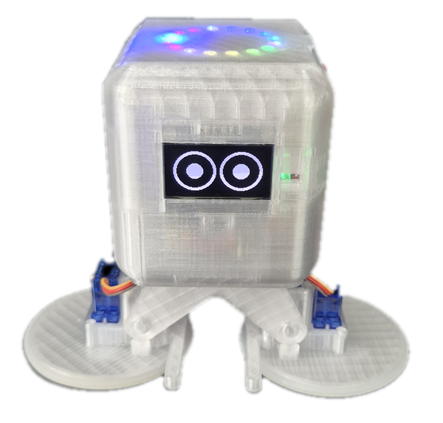
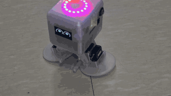

# OttoI2R

**생성형 AI(Claude, Gemini, ChatGPT 등)와 함께 배우는 피지컬 AI 로봇**

> **이 라이브러리와 Otto 로봇의 펌웨어, 응용 프로그램은 모두 생성형 AI(Claude)를 사용해서 개발했습니다.**
> 여러분도 같은 방법으로 만들 수 있습니다. 생성형 AI(Claude, Gemini, ChatGPT 등)에 **이 저장소의 주소와 만들고 싶은 동작**을 알려 주면, AI가 예제와 라이브러리를 읽고 로봇을 움직이는 프로그램을 자동으로 작성해 줍니다.
>
> *Everything here, the library and the Otto robot firmware and apps, was developed with a generative AI (Claude). You can do the same: give a generative AI (Claude, Gemini, ChatGPT, ...) the address of this repository and tell it what you want the robot to do, and it reads the examples and the library and writes the program for you.*

<table>
<tr>
<td></td>
<td></td>
</tr>
</table>

Otto 로봇(YL, YR, RL, RR 서보 4개)을 위한 Arduino 라이브러리입니다. 보드는 [i2r-05](https://github.com/kdi6033/i2r-05)(ESP32-S3)입니다.
핀 번호, 서보 초기화, 각도 보정, 걷기와 굴리기 같은 기본 동작이 들어 있습니다.

| 문서 | 내용 |
|---|---|
| [docs/guide.md](https://github.com/kdi6033/otto/blob/main/docs/guide.md) | 제작 가이드: 서보 이름과 핀, 로봇 맞추기, 걷기, 굴리기, 춤, OLED, LED, 센서 |
| [docs/protocol.md](https://github.com/kdi6033/otto/blob/main/docs/protocol.md) | 통신 프로토콜 v1.0 (초안): MQTT, BLE, 동작 명령, LLM 대화 |

두 문서는 [kdi6033/otto](https://github.com/kdi6033/otto) 저장소에 있습니다.

## 설치

**방법 1. Arduino IDE 라이브러리 관리자 (권장)**

1. Arduino IDE 왼쪽의 **라이브러리 관리자**(책 모양 아이콘)를 엽니다. (또는 **스케치 → 라이브러리 포함하기 → 라이브러리 관리**)
2. 검색창에 `OttoI2R`을 입력합니다.
3. **OttoI2R by i2r**의 **INSTALL**을 누릅니다. 설치되면 `1.0.0 installed`로 바뀝니다.

**방법 2. ZIP 파일로 설치** (라이브러리 관리자에서 찾을 수 없을 때)

1. 이 페이지 위쪽의 초록색 **Code** 버튼 → **Download ZIP**을 눌러 ZIP 파일을 내려받습니다. (GitHub에 로그인하지 않아도 됩니다)
2. Arduino IDE에서 **스케치 → 라이브러리 포함하기 → .ZIP 라이브러리 추가**를 누르고 내려받은 ZIP 파일을 선택합니다. ZIP 파일의 압축은 풀지 않습니다.

설치 후에는 어느 방법이든 **파일 → 예제 → OttoI2R**에서 예제를 열 수 있습니다.

- **추가로 설치할 라이브러리는 없습니다.** 서보는 ESP32 기본 PWM(LEDC)으로 직접 구동합니다.
- **ESP32 보드 패키지 3.0 이상**이 필요합니다. (보드 매니저에서 `esp32 by Espressif Systems` 3.x 설치)

## 사용

```cpp
#include <OttoI2R.h>

void setup() {
  ottoInit();       // 저장된 보정값을 불러오고 서보를 초기화한다
}

void loop() {
  walkFront();      // 앞으로 걷기
}
```

예제는 **파일 → 예제 → OttoI2R**에 있습니다. (walk, walk_front_speed, walk_back_speed, slide, rolling, rolling_front_speed, rolling_back_speed, hip_move, roll_one_foot)

속도를 정해서 움직이려면 `walkFront(속도)`, `walkBack(속도)`, `rollingFront(속도)`, `rollingBack(속도)`를 쓰세요. 속도는 20~200이고 100이 보통 속도입니다. (예: `walkFront(150);`)

## 먼저 할 일: Otto 펌웨어 설치

📺 **펌웨어 설치 방법은 유튜브 영상에 자세히 설명했습니다. 먼저 영상을 보세요: https://youtu.be/L9_3SZdu6Dk**

**보정(로봇 맞추기)을 하려면 보드에 Otto 펌웨어가 먼저 설치되어 있어야 합니다.** 보정은 이 펌웨어가 웹과 통신해서 값을 받아 보드에 저장하기 때문입니다.

1. 크롬(Chrome) 또는 엣지(Edge) 브라우저에서 [i2r.link](https://i2r.link)를 열고 위쪽 메뉴의 **펌웨어**를 누릅니다. (다른 브라우저에서는 동작하지 않습니다.)
2. ESP32 보드를 **USB로 컴퓨터에 연결**합니다.
3. 모델 그림 가운데 **otto**를 누르고, 나오는 창에서 보드의 **COM 포트를 선택**한 뒤 설치합니다.
4. 설치가 끝나면 보드를 WiFi에 연결해서 [i2r.link](https://i2r.link)에 기기로 등록합니다.

펌웨어 화면 위쪽의 **펌웨어 다운로드 방법** 링크에서도 설치 영상을 볼 수 있습니다.

> 이 펌웨어를 설치한 뒤에 아래 "보정"을 진행하세요. 내 스케치(예: `walk_front`)는 보정을 끝낸 다음에 올립니다.

## 보정 (로봇 맞추기)

로봇마다 조립 상태가 달라서 보정이 필요합니다. `ottoInit()`은 보드에 저장된 보정값(다리 수직, 발 속도, 걷기 기울기)을 불러옵니다.
**이 값은 [i2r.link](https://i2r.link) 웹에서 "로봇 맞추기"를 하고 [저장]을 눌러야 보드에 기록됩니다.** 저장하지 않으면 `ottoInit()`은 기본값을 씁니다.

**순서**

1. 위의 "Otto 펌웨어 설치"를 먼저 끝냅니다. (보드가 WiFi에 연결되어 [i2r.link](https://i2r.link)에 기기로 등록된 상태)
2. [i2r.link](https://i2r.link)에 로그인해서 내 Otto 기기 화면을 열고, **OTTO 조종 → 로봇 맞추기**를 누릅니다.
3. 화면의 4단계를 차례로 맞춥니다: 조립 자세 → 다리 수직(90도) → 굴리기 시험(두 발 속도) → 걷기 시험(발을 들 때 기울기).
4. 마지막에 **[저장 (보드 NVS)]** 을 누릅니다. "보드에 저장된 값이 있습니다"라고 나오면 저장된 것입니다.
5. 이제 Arduino IDE로 내 스케치(예: `walk_front`)를 올리면, `ottoInit()`이 방금 저장한 값을 불러와서 로봇에 맞게 움직입니다.

보정 변수(6개)의 뜻과 범위, 기본값, 코드에서 값을 넣는 함수 등 자세한 내용은 [Otto 제작 가이드 "3. 조립 후 모터 동작 확인과 초기셋"](https://github.com/kdi6033/otto/blob/main/docs/guide.md#-3-%EC%A1%B0%EB%A6%BD-%ED%9B%84-%EB%AA%A8%ED%84%B0-%EB%8F%99%EC%9E%91-%ED%99%95%EC%9D%B8%EA%B3%BC-%EC%B4%88%EA%B8%B0%EC%85%8B)를 참조하세요.

*English: First install the Otto firmware on the board from the i2r.link "펌웨어" (firmware) page (Chrome or Edge, USB connected, choose "otto"). Then `ottoInit()` loads the calibration stored on the board: set it on the Otto web page (i2r.link → OTTO control → "로봇 맞추기" / robot calibration) and press Save. Without a saved calibration, default values are used.*

## 주요 함수

| 구분 | 함수 |
|---|---|
| 초기화 | `ottoInit()` |
| 걷기 | `walkFront()`, `walkFront(속도)`, `walkBack()`, `walkBack(속도)`, `walkLeft()`, `walkRight()` |
| 미끄러지기 | `slideFront()`, `slideBack()`, `slideLeft()`, `slideRight()` |
| 굴리기 | `rollingFront()`, `rollingFront(속도)`, `rollingBack()`, `rollingBack(속도)`, `rollingLeft()`, `rollingRight()` |
| 자세와 발 | `moveHip(yr, yl)`, `rollRightFoot(속도)`, `rollLeftFoot(속도)`, `ottoRollFeet(rr, rl)` |
| 춤 | `danceRightRightTurn()` |
| 보정값 | `ottoLoadCalibration()`, `ottoSaveCalibration()`, `ottoClearCalibration()`, `ottoHasSavedCalibration()`, `ottoGetCalibration()`, `ottoSetCalibration(yl, yr, tiltR, tiltL, rl, rr)`, `ottoSetHipCenter(yl, yr)`, `ottoSetTilt(tiltR, tiltL)`, `ottoSetSpeed(rl, rr)` |

- `ottoInit()`: 서보를 움직이지 않고 보정값만 불러오려면 `ottoLoadCalibration()`을 쓰세요.
- `ottoInit(yl, yr)`: 다리 중심값을 직접 넘기는 방식입니다. (저장된 값은 불러오지 않음)
- `walkFront(속도)`, `walkBack(속도)`, `rollingFront(속도)`, `rollingBack(속도)`: 속도는 20~200(%)입니다. 100이 보정한 기본 속도이고, 100을 넘으면 보폭은 그대로 두고 기다리는 시간만 줄여서 걸음을 빠르게 합니다.
- 걷는 속도와 보폭 같은 고정값은 `src/OttoI2R.cpp`에 있습니다.

## 버전

1.0.0: 첫 배포.
